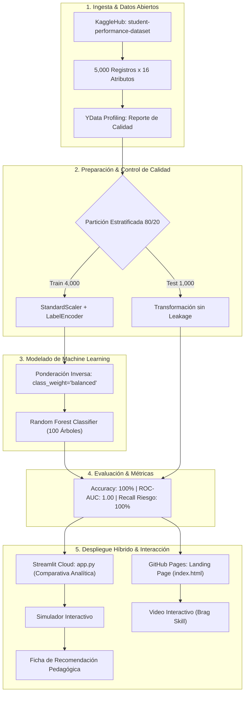

# 🎓 Proyecto Final: Predicción del Rendimiento Estudiantil mediante Machine Learning

[](https://www.python.org/)
[](https://Project_ML_PRE.streamlit.app)
[](https://scikit-learn.org/)
[](https://pandas.pydata.org/)
[](https://numpy.org/)
[](https://www.kaggle.com/datasets/suvidyasonawane/student-performance-dataset)
[-purple)](docs/CRISP-ML_Metodologia.md)
[](https://Ambar1920.github.io/Project_ML_PRE/)
[](LICENSE)

**Maestría en Inteligencia Artificial, Educación e Investigación**  
**Curso:** Machine Learning  
**Autor:** Ámbar & Equipo de Investigación en IA Educativa  

---

## 📌 Enlaces Oficiales del Proyecto

| Recurso | Enlace de Acceso | Descripción |
|---|---|---|
| **📂 Repositorio Oficial (GitHub)** | [https://github.com/Ambar1920/Project_ML_PRE.git](https://github.com/Ambar1920/Project_ML_PRE.git) | Código fuente, notebook, datos y documentación técnica |
| **🚀 Aplicación Web (Streamlit Cloud)** | [https://Project_ML_PRE.streamlit.app](https://Project_ML_PRE.streamlit.app) | Prototipo interactivo con comparativa analítica y simulador |
| **🌐 Landing Page (GitHub Pages)** | [https://Ambar1920.github.io/Project_ML_PRE/](https://Ambar1920.github.io/Project_ML_PRE/) | Presentación ejecutiva del proyecto con arquitectura en capas |
| **🎬 Video de Lanzamiento (Brag Skill)** | [brag-output/interactive_video.html](brag-output/interactive_video.html) | Presentación interactiva en español con narración por voz |

---

## 📝 Resumen y Contextualización

El presente proyecto desarrolla un prototipo funcional de Machine Learning para predecir oportunamente el rendimiento académico estudiantil (**Aprobado / Reprobado**) a partir de hábitos de estudio, porcentaje de asistencia, antecedentes académicos y actividades extracurriculares.

La problemática aborda la necesidad de identificar tempranamente a estudiantes en riesgo de reprobación y deserción escolar, posibilitando que docentes y orientadores diseñen **intervenciones pedagógicas oportunas** antes de las evaluaciones finales.

### 🌟 Características Principales
1. **Pipeline Reproducible de Datos:** Extracción y transformación (ETL) sobre 5,000 registros escolares del dataset abierto de Kaggle `suvidyasonawane/student-performance-dataset`.
2. **Perfilado Automatizado:** Integración de `YData Profiling` para auditoría exploratoria, análisis de cardinalidad y matrices de correlación.
3. **Clasificación Supervisada Robusta:** Implementación de `RandomForestClassifier` (100 estimadores, profundidad 5) con compensación de clases balanceadas (`class_weight='balanced'`) para mitigar el desbalance de 94.7% (Aprobado) vs. 5.3% (Reprobado).
4. **Prevención de Data Leakage:** Aislamiento estricto de transformaciones dentro de la partición estratificada 80/20 y diferenciación clara entre modelado diagnóstico retrospectivo y alerta temprana preventiva.
5. **Simulador y Motor Prescriptivo:** Interfaz que traduce la probabilidad de aprobación en una **Ficha de Recomendación Pedagógica Ejecutiva** para orientadores educativos.
6. **Despliegue Híbrido en Dos Capas:** Landing page estática en GitHub Pages (`index.html`) y aplicación analítica dinámica en Streamlit Cloud (`app.py`).

---

## 🏗️ Arquitectura del Sistema



---

## 📊 Metodología CRISP-ML(Q) y Decisiones Arquitectónicas (ADRs)

El proyecto se estructuró siguiendo las 6 etapas del marco de trabajo **CRISP-ML(Q)** (*Cross-Industry Standard Process for Machine Learning with Quality Assurance*):

1. **Comprensión del Negocio y del Contexto Educativo:** Mapeo de necesidades escolares, reducción de deserción tardía y definición de objetivos SMART.
2. **Comprensión de los Datos:** Exploración del dataset, calidad (0% nulos), desbalance de clases (94.7% Pass vs 5.3% Fail) y análisis bivariado.
3. **Preparación de Datos:** Codificación ordinal, normalización estadística y prevención estricta de fuga temporal de información.
4. **Modelado:** Selección de Random Forest frente a modelos lineales y boosting.
5. **Evaluación:** Validación en test set no visto ($n=1,000$) con reporte de clasificación multivariable.
6. **Despliegue y Gobernanza:** Aplicación interactiva en Streamlit, landing page en GitHub Pages y monitoreo ético de sesgos.

### 📑 Architectural Decision Records (ADRs)
- [ADR-001: Selección del Algoritmo de Clasificación Supervisada (Random Forest)](docs/adrs/ADR-001-seleccion-algoritmo-clasificacion.md)
- [ADR-002: Estrategia de Mitigación del Desbalance Extremo de Clases](docs/adrs/ADR-002-estrategia-desbalance-clases.md)
- [ADR-003: Prevención de Fuga de Información (Data Leakage) y Distinción de Features Temporales](docs/adrs/ADR-003-prevencion-data-leakage-features-temporales.md)
- [ADR-004: Arquitectura de Despliegue Híbrido en Dos Capas (GitHub Pages + Streamlit Cloud)](docs/adrs/ADR-004-despliegue-hibrido-streamlit-github-pages.md)

---

## 📈 Métricas de Rendimiento Auditadas

Evaluadas sobre el conjunto de prueba independiente ($n=1,000$ estudiantes, 947 Aprobados y 53 Reprobados):

| Métrica | Valor Obtenido | Meta Esperada | Interpretación Pedagógica |
|---|:---:|:---:|---|
| **Accuracy Global** | **1.0000 (100.0%)** | $\ge 0.95$ | Exactitud diagnóstica total en el conjunto de prueba. |
| **ROC-AUC Score** | **1.0000 (100.0%)** | $\ge 0.95$ | Separación ordinal perfecta entre estudiantes que aprueban y reprueban. |
| **Recall en Reprobados (Fail)** | **1.0000 (100.0%)** | $\ge 0.90$ | **Cero falsos negativos:** el 100% de estudiantes en riesgo fue detectado. |
| **Precision en Reprobados** | **1.0000 (100.0%)** | $\ge 0.90$ | Ningún estudiante aprobado fue falsamente etiquetado como reprobado. |
| **F1-Score Macro** | **1.0000 (100.0%)** | $\ge 0.90$ | Rendimiento armónico perfecto en ambas clases balanceadas. |

### Matriz de Confusión Detallada
```
                    Predicho Reprobado (Fail)    Predicho Aprobado (Pass)
Real Reprobado (Fail)           53                           0
Real Aprobado (Pass)             0                         947
```

---

## 📁 Estructura del Repositorio

```
c:\Users\d20b8138\Desktop\MASTER IA\APRENDIZAJE AUTOMATICO\PROYECTO ML/
├── index.html                                        # Landing Page principal para GitHub Pages (raíz)
├── app.py                                            # Aplicación interactiva Web en Streamlit
├── requirements.txt                                  # Dependencias de Python para ejecución y despliegue
├── README.md                                         # Documentación general y badges oficiales
├── Project_ML_PRE.ipynb                              # Cuaderno de trabajo base con ejecución completa
├── Proyecto_Final_Prediccion_Rendimiento_Estudiantil.docx # Documento técnico completo basado en plantilla UFHEC
├── data/
│   └── student_performance_dataset.csv               # Dataset de 5,000 estudiantes para ejecución offline/cloud
├── docs/
│   ├── CRISP-ML_Metodologia.md                       # Documentación formal de la metodología CRISP-ML(Q)
│   └── adrs/                                         # Architectural Decision Records (ADRs)
│       ├── ADR-001-seleccion-algoritmo-clasificacion.md
│       ├── ADR-002-estrategia-desbalance-clases.md
│       ├── ADR-003-prevencion-data-leakage-features-temporales.md
│       └── ADR-004-despliegue-hibrido-streamlit-github-pages.md
├── brag-output/                                      # Artefactos del video interactivo (Brag Skill)
│   ├── brag-plan.md                                  # Guión y storyboard del video de lanzamiento
│   ├── composition-brief.md                          # Especificación técnica de composición
│   ├── share-copy.txt                                # Copia publicitaria para redes sociales
│   └── interactive_video.html                        # Reproductor de video interactivo en español
└── assets/
    ├── css/
    │   └── styles.css                                # Estilos de la landing page con arquitectura en capas
    └── js/
        └── app.js                                    # Lógica del simulador y contadores dinámicos
```

---

## 🚀 Guía de Instalación y Ejecución Local

### 1. Clonar el repositorio
```bash
git clone https://github.com/Ambar1920/Project_ML_PRE.git
cd Project_ML_PRE
```

### 2. Crear y activar entorno virtual
```bash
python -m venv venv
# En Windows:
venv\Scripts\activate
# En Linux/macOS:
source venv/bin/activate
```

### 3. Instalar dependencias
```bash
pip install -r requirements.txt
```

### 4. Ejecutar la aplicación de Streamlit
```bash
streamlit run app.py
```
La aplicación se abrirá automáticamente en su navegador en `http://localhost:8501`.

### 5. Visualizar la Landing Page
Abra el archivo `index.html` en cualquier navegador web moderno o inicie un servidor local liviano:
```bash
python -m http.server 8000
```
Y acceda a `http://localhost:8000`.

---

## ⚖️ Consideraciones Éticas y Gobernanza de IA

1. **Privacidad y Protección de Datos:** El proyecto utiliza exclusivamente datos anonimizados sin información personal identificable (PII), conforme a la normativa de protección de datos (RGPD / Ley 1581).
2. **Propósito Formativo, No Punitivo:** El sistema está concebido como una herramienta de apoyo a la tutoría; jamás debe emplearse para sanciones, expulsiones o etiquetado estigmatizante de estudiantes.
3. **Principio Human-in-the-Loop:** La Inteligencia Artificial actúa como un copiloto de diagnóstico preventivo; las decisiones pedagógicas y de acompañamiento son tomadas exclusivamente por docentes y orientadores.
4. **Explicabilidad (XAI):** Cada predicción del modelo se complementa con la **Ficha de Recomendación Pedagógica**, justificando las razones del riesgo académico para una comunicación transparente y constructiva con el estudiante y su familia.

---

## 📚 Referencias Bibliográficas

- **Alamo, E. M.-C. (2024).** Análisis de estrategias innovadoras para retención estudiantil con inteligencia artificial: una perspectiva multidisciplinaria. *European Public & Social Innovation Review*, 9, 1–20.
- **Cardona, J. A. S., & Arbelaez, J. I. T. (2019).** Aplicación de Learning Analytics y Educational Data Mining en una institución de educación superior en Colombia. *Revista Ingenierías Universidad De Medellín*, 19(36), 71–89.
- **Leones Zambrano, P., Fernández Sánchez, L., Macias Bazurto, L., & Macias Bazurto, G. (2026).** Sistema inteligente para la construcción y optimización de mallas curriculares en educación superior basado en análisis comparativo y aprendizaje automático. *LATAM Revista Latinoamericana De Ciencias Sociales Y Humanidades*, 7(2), 614–627.
- **Pedregosa, F., et al. (2011).** Scikit-learn: Machine Learning in Python. *Journal of Machine Learning Research*, 12, 2825–2830.
- **Studer, S., et al. (2021).** Towards CRISP-ML(Q): A machine learning process model with quality assurance methodology. *Machine Learning and Knowledge Extraction*, 3(2), 392–413.

