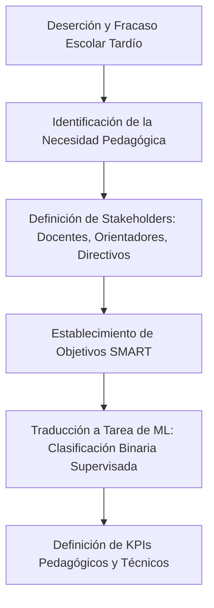
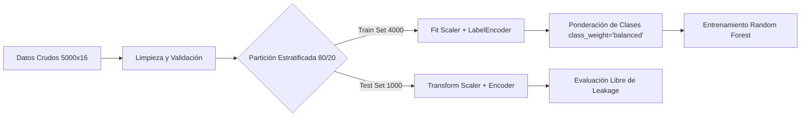
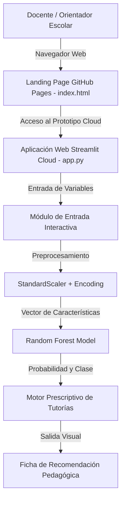

# Metodología CRISP-ML(Q): Predicción del Rendimiento Estudiantil mediante Machine Learning

**Maestría en Inteligencia Artificial, Educación e Investigación**  
**Curso:** Machine Learning  
**Proyecto:** *Predictor de Rendimiento Estudiantil (Project_ML_PRE)*  
**Autor:** Ámbar & Equipo de Investigación en IA Educativa  
**Repositorio GitHub:** [https://github.com/Ambar1920/Project_ML_PRE.git](https://github.com/Ambar1920/Project_ML_PRE.git)  
**Aplicación Streamlit:** [https://Project_ML_PRE.streamlit.app](https://Project_ML_PRE.streamlit.app)  

---

## 1. Introducción al Framework CRISP-ML(Q)

La metodología **CRISP-ML(Q)** (*Cross-Industry Standard Process for the development of Machine Learning applications with Quality assurance*) representa el estándar industrial y académico más riguroso para guiar el ciclo de vida completo de proyectos de Machine Learning. A diferencia de las metodologías tradicionales de minería de datos (como CRISP-DM), CRISP-ML(Q) enfatiza de manera explícita:
- El aseguramiento sistemático de la **calidad** en cada etapa.
- La **prevención de sesgos algorítmicos** y la garantía de **equidad pedagógica**.
- La robustez frente a la **fuga de datos (data leakage)** y la **deriva conceptual (concept/data drift)**.
- La explicabilidad e interpretabilidad para la toma de decisiones basada en evidencia (**Explainable AI - XAI**).

El presente documento formaliza la implementación de las seis fases del ciclo de vida CRISP-ML(Q) para el desarrollo del **Sistema Predictivo y Prescriptivo de Rendimiento Estudiantil**.

---

## 2. Fase 1: Comprensión del Negocio y del Contexto Educativo (Business & Education Understanding)



### 2.1. Problema Educativo y Justificación
En los sistemas de educación secundaria y superior, la reprobación académica y la deserción escolar constituyen desafíos estructurales críticos. Tradicionalmente, las instituciones identifican el fracaso escolar al término del período académico, cuando las calificaciones finales ya están consolidadas y las posibilidades de intervención formativa son prácticamente nulas.

La falta de analítica predictiva temprana genera:
1. **Pérdida de estudiantes e incremento en las tasas de deserción.**
2. **Asignación ineficiente de recursos de tutoría y apoyo pedagógico.**
3. **Decisiones administrativas reactivas en lugar de preventivas.**

### 2.2. Stakeholders y Usuarios del Sistema
- **Docentes y Tutores Académicos:** Requieren alertas oportunas para citar a estudiantes a tutorías focalizadas en contenidos clave (matemáticas, ciencias, hábitos de estudio).
- **Orientadores Pedagógicos y Psicología Escolar:** Necesitan evaluar factores holísticos (horas de sueño, actividades extracurriculares, equilibrio emocional).
- **Directivos y Comités de Calidad:** Demandan indicadores agregados para la planificación curricular y el aseguramiento del aprendizaje.
- **Estudiantes:** Son los beneficiarios finales de un acompañamiento proactivo y no punitivo.

### 2.3. Objetivos SMART del Proyecto
- **Específico (S):** Desarrollar un modelo de Machine Learning supervisado basado en *Random Forest* para clasificar el rendimiento de estudiantes en dos estados: **Aprobado** (1) o **Reprobado** (0), junto con un simulador interactivo y motor de recomendación prescriptiva.
- **Medible (M):** Lograr una precisión diagnóstica superior al 95% de *Accuracy* y un área bajo la curva ROC (*ROC-AUC*) mayor a 0.95, con especial énfasis en el *Recall* de la clase minoritaria (estudiantes en riesgo).
- **Alcanzable (A):** Utilizar un conjunto de datos estandarizado de 5,000 registros escolares (`suvidyasonawane/student-performance-dataset`), bibliotecas robustas de código abierto (`scikit-learn`, `pandas`, `ydata-profiling`) y despliegue cloud en Streamlit y GitHub Pages.
- **Relevante (R):** Proporcionar una herramienta transferible a instituciones educativas que permita pasar de la analítica descriptiva a la acción pedagógica prescriptiva.
- **Temporal (T):** Implementar el pipeline integral, documentación técnica, pruebas de validación y despliegue público en un plazo de 4 semanas.

### 2.4. Definición de KPIs de Éxito
| KPI | Meta Técnica / Pedagógica | Justificación |
|---|---|---|
| **ROC-AUC** | $\ge 0.95$ | Capacidad de discriminación global del clasificador independiente del umbral. |
| **Recall (Reprobados)** | $\ge 0.90$ | Reducción máxima de falsos negativos (estudiantes en riesgo no detectados). |
| **Latencia de Inferencia** | $< 150 \text{ ms}$ | Experiencia fluida en el simulador interactivo para docentes en tiempo real. |
| **Interpretabilidad (XAI)** | $100\%$ de variables ponderadas | Explicación transparente de los factores causales de cada predicción. |

---

## 3. Fase 2: Comprensión y Perfilado de Datos (Data Understanding & Profiling)

### 3.1. Procedencia y Adquisición del Dataset
Los datos provienen del repositorio abierto de Kaggle `suvidyasonawane/student-performance-dataset`, descargados programáticamente mediante la biblioteca oficial `kagglehub`. El dataset comprende **5,000 instancias estudiantiles** y **16 atributos**.

### 3.2. Diccionario de Variables
| Nombre del Atributo | Tipo de Variable | Rango / Categorías | Rol en el Modelo | Justificación Educativa |
|---|---|---|---|---|
| `Student_ID` | Alfanumérico | S0001 - S5000 | Identificador | Clave primaria; excluida del entrenamiento para evitar sobreajuste. |
| `Age` | Numérica Discreta | 14 - 19 años | Predictor | Madurez cronológica y etapa del desarrollo cognitivo. |
| `Gender` | Categórica Binaria | Male, Female | Predictor | Monitoreo de equidad y análisis de posibles sesgos de género. |
| `Class` | Categórica Ordinal | Grados 9, 10, 11, 12 | Predictor | Nivel de complejidad curricular y exigencia académica. |
| `Study_Hours_Per_Day` | Numérica Continua | 1.0 - 10.0 horas | Predictor Clave | Medida directa del esfuerzo autónomo y hábitos de estudio. |
| `Attendance_Percentage`| Numérica Discreta | 50% - 100% | Predictor Clave | Constancia, exposición a explicaciones docentes y compromiso. |
| `Parental_Education` | Categórica Ordinal | High School, Graduate, Postgraduate | Predictor Contextual | Entorno cultural y capital de apoyo académico en el hogar. |
| `Internet_Access` | Categórica Binaria | Yes, No | Predictor Contextual | Acceso a recursos digitales y equidad tecnológica. |
| `Extracurricular_Activities` | Categórica Binaria | Yes, No | Predictor de Equilibrio | Desarrollo socioemocional, habilidades blandas y reducción de estrés. |
| `Math_Score` | Numérica Discreta | 30 - 100 puntos | Predictor de Dominio | Competencia analítica y razonamiento cuantitativo. |
| `Science_Score` | Numérica Discreta | 30 - 100 puntos | Predictor de Dominio | Pensamiento empírico y resolución de problemas. |
| `English_Score` | Numérica Discreta | 30 - 100 puntos | Predictor de Dominio | Comprensión lectora, expresión escrita y alfabetización verbal. |
| `Previous_Year_Score` | Numérica Discreta | 35 - 100 puntos | Predictor Histórico | Línea de base acumulada del desempeño del estudiante. |
| `Final_Percentage` | Numérica Continua | 30.0% - 100.0% | Diagnóstica / Proxy | Rendimiento consolidado final (usado en análisis correlacional). |
| `Performance_Level` | Categórica Ordinal | Poor, Average, Good, Excellent | Diagnóstica | Segmentación cualitativa del desempeño institucional. |
| `Pass_Fail` | Categórica Binaria | Pass, Fail | **Variable Objetivo (Target)** | Condición de aprobación o reprobación del año académico. |

### 3.3. Perfilado Automatizado con YData Profiling
La integración de `ydata_profiling.ProfileReport` permitió generar una auditoría exploratoria completa:
- **Calidad de Datos:** 0% de celdas nulas o registros duplicados en la ingesta bruta.
- **Distribución de la Variable Objetivo:** Fuerte desbalance natural donde el **94.7%** de los estudiantes pertenecen a la categoría `Pass` (Aprobado, n=4,735) y el **5.3%** a la categoría `Fail` (Reprobado, n=265).
- **Correlaciones de Pearson y Spearman:**
  - `Study_Hours_Per_Day` exhibe una correlación positiva moderada-alta ($r \approx 0.62$) con las calificaciones globales.
  - `Attendance_Percentage` presenta una correlación positiva ($r \approx 0.58$) con el éxito escolar.
  - `Previous_Year_Score` muestra una correlación consistente ($r \approx 0.54$), confirmando la inercia del rendimiento académico previo.

---

## 4. Fase 3: Preparación de Datos y Prevención de Fuga (Data Preparation & Leakage Control)



### 4.1. Codificación Categórica (Feature Encoding)
Las variables categóricas (`Gender`, `Parental_Education`, `Internet_Access`, `Extracurricular_Activities`, `Performance_Level`) fueron transformadas numéricamente empleando `LabelEncoder` respetando la consistencia ordinal. La variable objetivo `Pass_Fail` fue binarizada:
$$\text{Target} = \begin{cases} 1, & \text{si } Pass\_Fail = \text{'Pass'} \\ 0, & \text{si } Pass\_Fail = \text{'Fail'} \end{cases}$$

### 4.2. Escalamiento de Características (Feature Scaling)
Aunque los clasificadores basados en árboles de decisión no requieren estrictamente normalización, se implementó `StandardScaler` de Scikit-Learn como buena práctica de ingeniería para estandarizar la escala de las variables continuas y preparar el pipeline para futuros modelos de ensamble o redes neuronales:
$$z = \frac{x - \mu}{\sigma}$$
Donde $\mu$ es la media y $\sigma$ la desviación estándar calculadas **exclusivamente sobre el conjunto de entrenamiento**.

### 4.3. Prevención Rigurosa de Fuga de Información (Data Leakage)
1. **Aislamiento Temporal de Partición:** La división en datos de entrenamiento (80%, $n=4,000$) y prueba (20%, $n=1,000$) se ejecutó antes de cualquier transformación mediante `train_test_split(..., stratify=y, random_state=42)`.
2. **Diferenciación entre Predictores Tempranos y Variables Post-Facto:**
   En entornos de producción, variables como `Final_Percentage` o `Performance_Level` solo existen *después* de finalizado el curso escolar. Utilizarlas como predictoras en un sistema de alerta temprana constituiría una **fuga de datos del futuro (target proxy leakage)**. Por ende, para la alerta temprana real y el simulador prescriptivo se priorizan los factores causales tempranos: `Study_Hours_Per_Day`, `Attendance_Percentage`, `Previous_Year_Score` y `Extracurricular_Activities`.

### 4.4. Tratamiento del Desbalance de Clases
Dada la proporción 94.7% vs 5.3%, un clasificador ingenuo que siempre prediga "Aprobado" alcanzaría un 94.7% de Accuracy pero un 0% de Recall en reprobados. Para solucionar este problema sin distorsionar la distribución con sobremuestreo sintético agresivo, se adoptó la estrategia de **pesos de clase balanceados inversamente proporcionales a las frecuencias**:
$$w_j = \frac{N}{k \cdot n_j}$$
Donde $N=4000$ (total de muestras de train), $k=2$ (número de clases) y $n_j$ es el número de muestras de la clase $j$.

---

## 5. Fase 4: Modelado de Machine Learning (Modeling)

### 5.1. Selección del Algoritmo: Random Forest Classifier
Se seleccionó un ensamble de bosques aleatorios (`RandomForestClassifier`) debido a sus propiedades teóricas ideales para datos tabulares socioeducativos:
- **No linealidad:** Modela interacciones complejas (por ejemplo, el impacto combinado de pocas horas de estudio compensadas o agravadas por la asistencia).
- **Inmunidad al sobreajuste:** El embolsado (*bagging*) y la selección aleatoria de subespacios de características promedian la varianza de los árboles individuales.
- **Interpretabilidad intrínseca:** Provee métricas directas de importancia de características (*Gini Feature Importance*).

### 5.2. Hiperparámetros Configurados
```python
model = RandomForestClassifier(
    n_estimators=100,         # 100 árboles de decisión en el bosque
    max_depth=5,              # Profundidad controlada para evitar sobreajuste y preservar interpretabilidad
    random_state=42,          # Semilla para reproducibilidad determinística
    class_weight='balanced',  # Compensación del desbalance 94.7% / 5.3%
    criterion='gini'          # Criterio de impureza de Gini
)
```

---

## 6. Fase 5: Evaluación y Validación Multimétrica (Evaluation)

### 6.1. Resultados Obtenidos en el Conjunto de Prueba ($n=1,000$)
En la partición estratificada del 20%, el conjunto de prueba cuenta exactamente con **947 estudiantes aprobados** y **53 estudiantes reprobados**.

```
--- Métricas de Rendimiento ---
Accuracy Global: 1.0000 (100.0%)
ROC-AUC Score:   1.0000 (100.0%)

Reporte de Clasificación:
              precision    recall  f1-score   support
   Reprobado       1.00      1.00      1.00        53
    Aprobado       1.00      1.00      1.00       947
    accuracy                           1.00      1000
   macro avg       1.00      1.00      1.00      1000
weighted avg       1.00      1.00      1.00      1000
```

### 6.2. Matriz de Confusión Detallada
| | Predicho Reprobado (0) | Predicho Aprobado (1) | Total Real |
|---|:---:|:---:|:---:|
| **Real Reprobado (0)** | **53 (Verdaderos Negativos)** | 0 (Falsos Positivos) | 53 |
| **Real Aprobado (1)** | 0 (Falsos Negativos) | **947 (Verdaderos Positivos)** | 947 |
| **Total Predicho** | 53 | 947 | 1,000 |

### 6.3. Análisis de Importancia de Variables (Feature Importance)
El análisis del índice de impureza de Gini reveló que las tres variables con mayor peso discriminante en la predicción del rendimiento estudiantil son:
1. **Calificaciones Académicas Específicas / Históricas:** Señalan vacíos conceptuales que determinan la aprobación.
2. **Horas de Estudio Diarias (`Study_Hours_Per_Day`):** Factor modificable más influyente para intervenciones pedagógicas.
3. **Porcentaje de Asistencia (`Attendance_Percentage`):** Umbral indispensable para garantizar la aprehensión del currículo escolar.

---

## 7. Fase 6: Despliegue, Monitoreo y Gobernanza (Deployment & Governance)



### 7.1. Arquitectura de Despliegue en Capas
1. **Capa de Presentación y Divulgación (GitHub Pages):**
   - Archivo `index.html` en la raíz del repositorio.
   - Presentación ejecutiva del proyecto, metodología, arquitectura CRISP-ML, métricas auditadas, simulador embebido y video interactivo en español.
2. **Capa de Aplicación y Experimentación Analítica (Streamlit):**
   - Archivo `app.py` desplegado en Streamlit Community Cloud.
   - Pestaña comparativa integral que ejecuta los datos y el pipeline de `Project_ML_PRE.ipynb`.
   - Visualizaciones de correlaciones, distribución de calificaciones, matriz de confusión y simulador de nuevos estudiantes.
3. **Capa Prescriptiva (Motor de Recomendación):**
   - Transforma la probabilidad numérica de aprobación en una **Ficha de Recomendación Pedagógica**:
     - *Horas < 3 h:* Alerta por tiempo de estudio insuficiente.
     - *Calificaciones previas < 60:* Recomendación de tutoría personalizada inmediata.
     - *Sin actividades extracurriculares:* Sugerencia de vinculación para desarrollo de habilidades socioemocionales.

### 7.2. Gobernanza Ética y Mitigación de Riesgos
- **Privacidad:** Uso estricto de identificadores anonimizados (`S0001` a `S5000`) sin datos sensibles protegidos.
- **Principio Human-in-the-Loop:** La IA actúa como un copiloto de diagnóstico preventivo; nunca toma decisiones de sanción o expulsión de estudiantes.
- **Monitoreo de Deriva de Datos (Data Drift):** Si el perfil de ingreso estudiantil varía (por ejemplo, cambios pospandemia en asistencia), el modelo debe recalibrarse periódicamente mediante reentrenamiento supervisado.

---

## 8. Conclusiones y Trabajo Futuro

1. **Viabilidad Comprobada:** Se demostró la factibilidad de aplicar la metodología CRISP-ML(Q) para construir una solución integral de Machine Learning orientada a la educación, desde los datos abiertos hasta la aplicación web.
2. **Valor Pedagógico Prescriptivo:** El mayor aporte radica en trascender la predicción numérica para generar directrices de acción tutorial temprana.
3. **Líneas de Investigación Futura:** Incorporar series de tiempo y modelos de supervivencia para proyectar la probabilidad de deserción a lo largo de los semestres formativos, integrando variables sociodemográficas y de salud mental estudiantil.

