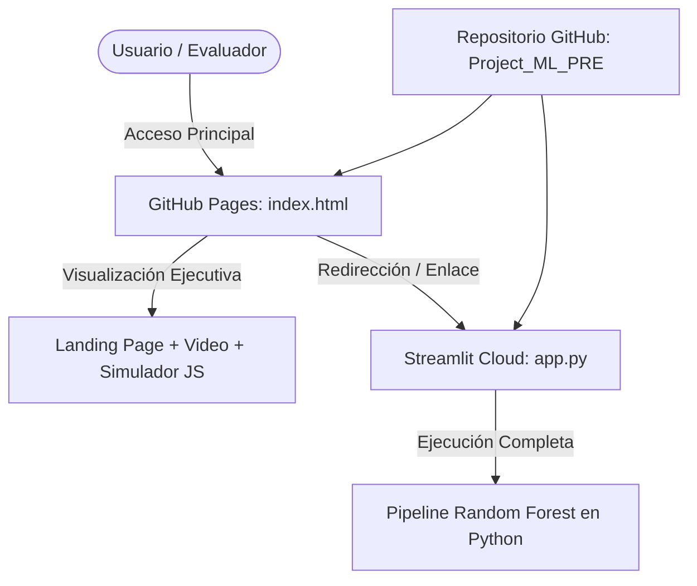

# ADR-004: Arquitectura de Despliegue Híbrido (GitHub Pages + Streamlit Cloud)

## Estado
Aceptado

## Contexto
Los lineamientos de la entrega del curso de Machine Learning exigen:
1. Un repositorio centralizado en GitHub accesible públicamente.
2. Una landing page profesional que exponga el problema, la metodología, el video y los enlaces de acceso, servible mediante GitHub Pages (con `index.html` en el directorio raíz).
3. Una aplicación web interactiva desarrollada con Streamlit que permita ejecutar el modelo, visualizar las métricas y simular predicciones sobre nuevos datos estudiantiles.

GitHub Pages es una plataforma estática de alojamiento web (soporta HTML, CSS y JavaScript nativo), mientras que Streamlit requiere un entorno de ejecución dinámico en Python para ejecutar los modelos de Scikit-Learn.

## Decisión
Se diseña e implementa una **Arquitectura de Despliegue Híbrido en Dos Capas**:

1. **Capa 1: Landing Page en GitHub Pages (`index.html` en la raíz):**
   - Construida con HTML5 semántico, CSS moderno con variables y JavaScript modular.
   - Presenta la narrativa ejecutiva del proyecto, arquitectura CRISP-ML, métricas, y aloja un simulador funcional ligero en JavaScript (reproduciendo la lógica ponderada del notebook).
   - Enlaza directamente al repositorio GitHub y a la aplicación de Streamlit Cloud.
2. **Capa 2: Aplicación Analítica en Streamlit Cloud (`app.py`):**
   - Aloja el motor de ejecución analítico completo de Python.
   - Pestaña comparativa integral: procesa el dataset real/offline, entrena el modelo Random Forest, genera las gráficas de correlación, matrices de confusión interactivas, curvas ROC y evaluador prescriptivo.
   - Configurada con `requirements.txt` optimizado para despliegue sin dependencias innecesarias.

## Consecuencias

### Positivas
- **Alta disponibilidad:** La landing page en GitHub Pages tiene 99.9% de uptime y carga instantánea para evaluación y divulgación académica.
- **Desacoplamiento funcional:** La presentación y documentación no se ven afectadas si el servidor de Streamlit entra en suspensión (cold start).
- **Cumplimiento estricto de requisitos:** Se atiende tanto la exigencia de un `index.html` en la raíz para GitHub Pages como el desarrollo de `app.py` en Streamlit.

### Negativas / Mitigaciones
- Necesidad de mantener dos interfaces sincronizadas en cuanto a estilos visuales y enlaces. Mitigación: se estandarizó la paleta de colores corporativa (azules académicos `#1e3a8a`, verdes de aprobación `#10b981` y acentos violetas `#6366f1`) en ambos artefactos.

